<p align='center'>
  
</p>


# Over-the-wire [](https://github.com/vaguue/over-the-wire/blob/main/LICENSE) [](https://www.npmjs.com/package/over-the-wire) 

*The project is currently under active development.*

## Overview
`over-the-wire` is a Node.js packet manipulation library supporting:
- Packet crafting and parsing
- Capturing network traffic and sending packets in all formats
- Parsing and serializing pcap and pcapng file formats
- Creating custom non-TCP/UDP socket instances

## System Requirements
- Libpcap/WinPcap/Npcap library installed (if Wireshark is installed on your system, you are good to go)
- Node.js 18 or higher. The package is an ES module: use `import`. `require('over-the-wire')` works on Node.js versions that can load ES modules through `require` (20.19+, 22.12+) and returns the module namespace, so the callable is `require('over-the-wire').default`.
- C++ compiler, if there are no prebuilt bindings for your system

## Installation

```bash
npm install over-the-wire --save
```

## Recipes
Short scripts for common tasks, in [`recipes/`](./recipes) and as the first chapter of the [documentation](https://vaguue.github.io/over-the-wire/):

- [Did my handshake get an answer?](./recipes/handshake-answered.md)
- [Send a packet and wait for the reply](./recipes/send-and-wait.md)
- [Traceroute](./recipes/traceroute.md)
- [Capture traffic into a pcapng file](./recipes/capture-to-file.md)
- [Read a capture file](./recipes/read-capture-file.md)
- [Craft a packet byte for byte](./recipes/craft-by-hand.md)

## Getting started
This is traceroute, written with the Node.js standard library and over-the-wire. Each probe is described from the IP layer up; the interface, the source addresses and the gateway's link-layer address are filled in the way the host would send it. The script waits for each answer with a timeout and saves the whole exchange to a pcapng file.

```javascript
import fs from 'node:fs';
import dns from 'node:dns/promises';

import otw from 'over-the-wire';

const ECHO_REQUEST = 8;
const ECHO_REPLY = 0;
const TIME_EXCEEDED = 11;
const MAX_HOPS = 30;
const ANSWER_TIMEOUT_MS = 1000;

const traceroute = async (host) => {
  const { address: target } = await dns.lookup(host, { family: 4 });

  const wire = otw();
  const capture = await wire.capture(wire.filter().icmp());

  const dump = otw.Pcap.createWriteStream({ format: 'pcapng' });
  dump.pipe(fs.createWriteStream('traceroute.pcapng'));
  capture.pipe(dump);

  const id = Math.floor(Math.random() * 0xffff);

  console.log(`traceroute to ${host} (${target}), ${MAX_HOPS} hops max`);

  for (let timeToLive = 1; timeToLive <= MAX_HOPS; timeToLive++) {
    const probe = await wire.packet()
      .ipv4({ dst: target, timeToLive })
      .icmp({ type: ECHO_REQUEST, id, sequence: timeToLive });

    const addressedToUs = wire.filter()
      .ipv4({ dst: probe.layers.IPv4.src })
      .icmp({ type: [ECHO_REPLY, TIME_EXCEEDED] });

    const sentAt = Date.now();
    capture.write(probe);
    const answer = await capture.expect(addressedToUs, { timeout: ANSWER_TIMEOUT_MS });

    if (answer === null) {
      console.log(`${timeToLive}  *`);
      continue;
    }

    console.log(`${timeToLive}  ${answer.layers.IPv4.src}  ${Date.now() - sentAt} ms`);

    if (answer.layers.ICMP.type === ECHO_REPLY) {
      break;
    }
  }

  capture.destroy();
  dump.end();
};

traceroute(process.argv[2] ?? '8.8.8.8').catch((err) => {
  console.error(err);
  process.exitCode = 1;
});
```

Capturing needs the same privileges as tcpdump, so run it with `sudo` unless your user can already open capture devices.

### Building packets the way the host would send them

`otw()` returns a context that knows the routing table, the neighbour table and the local interfaces. A packet described through it can be awaited: the interface, the source addresses and the next hop's link-layer address are filled in the way the network stack would, and the Ethernet layer is added when it's left out.

```javascript
import otw from 'over-the-wire';

const wire = otw();

const pkt = await wire.packet()
  .ipv4({ dst: '8.8.8.8' })
  .icmp({ type: 8, id: 1, sequence: 1 });

console.log(pkt.iface.name, pkt.layers.Ethernet.dst, pkt.layers.IPv4.src);
```

- Anything set explicitly is kept as written.
- Without `await`, nothing is looked up: `.build()` and `.buffer` give the packet exactly as described, and writing the un-awaited builder to a device sends that.
- `otw({ iface: 'en0' })` binds the context to one interface. Lookups are cached per context for a few seconds, `wire.flush()` drops them.
- The link layer follows the interface: Ethernet where there is one, the loopback header on tunnels and loopback interfaces, none where the interface carries bare IP.
- An unknown next hop is resolved by the host: one empty-handed datagram is sent to it so the kernel performs ARP or neighbour discovery, and the answer is read back from the neighbour table.
- When something can't be resolved the promise rejects with a `code`: `ENOROUTE`, `ENONEIGHBOUR` (the next hop did not answer) or `ENOADDRESS`.
- `otw.registerLayer(MyLayer)` adds a protocol to the builders.

### Filters, capturing and waiting for an answer

`wire.filter()` describes packets with the same layer and field names as the packet builder. A filter compiles to a capture filter expression where one exists, and matches parsed packets in process either way.

```javascript
const handshake = wire.filter()
  .ipv4({ host: '203.0.113.10' })
  .udp({ port: 51820 });

handshake.toString();
// 'ip and ip host 203.0.113.10 and udp and udp port 51820'

handshake.matches(packet);
```

- Values can be a single value, a list of alternatives, a comparison (`{ lt: 5 }`, `gt`, `lte`, `gte`, `ne`) or a function.
- `host` and `port` match either direction. TCP flags are matched by name: `.tcp({ flags: { syn: 1, ack: 0 } })`.
- `.or(other)` and `.not(other)` take a filter or a function describing one; `.raw('...')` embeds a capture filter expression.
- Fields with no capture filter equivalent still match in process; `filter.expressible` tells which kind a filter is.

Devices and socket streams can wait for a packet. `expect` resolves with the next packet matching a filter, or `null` when the timeout passes. Packets that arrive between two calls are kept, so nothing is missed in between.

```javascript
const capture = await wire.capture(handshake);

const outgoing = await capture.expect(wire.filter().ipv4({ dst: '203.0.113.10' }), { timeout: 30000 });
const incoming = await capture.expect(wire.filter().ipv4({ src: '203.0.113.10' }), { timeout: 5000 });

console.log(incoming === null ? 'no reply' : 'answered');
```

`wire.send(packet)` resolves the packet if it is still a description, writes it to the interface it routes through, and can wait for the answer:

```javascript
const reply = await wire
  .send(wire.packet().ipv4({ dst: '203.0.113.10' }).udp({ src: 40000, dst: 51820 }).payload({ data }))
  .expect(wire.filter().udp({ src: 51820 }), { timeout: 2000 });
```

`wire.close()` closes the devices opened by `send`.

## Documentation

[Here :)](https://vaguue.github.io/over-the-wire)

## Questions or Suggestions
Feel free to open any issue in the Issues section of this repository. Currently, there are no restrictions on the format.
